# Amulya & Vedant — complete website source

Published revision 5. This is the complete HTML, CSS and JavaScript, not a simplified example. Binary assets are supplied in the ZIP’s `assets/` directory. `standalone.html` embeds those assets, the CSS and the JavaScript into one file.

## index.html

```html
<!doctype html>
<html lang="en">
<head>
  <meta charset="utf-8"><meta name="viewport" content="width=device-width, initial-scale=1, viewport-fit=cover"><meta name="theme-color" content="#f6ead5">
  <title>Amulya & Vedant · The Wedding Invitation</title>
  <meta name="description" content="With love and blessings, join Amulya Agrawal and Vedant Jain for their wedding celebrations in Varanasi, 24–26 November 2026.">
  <meta property="og:type" content="website"><meta property="og:title" content="Amulya & Vedant · You're Invited"><meta property="og:description" content="26 November 2026 · Hotel De Paris, Varanasi. With love and blessings, Agrawal Family."><meta property="og:url" content="https://amulya-vedant-lotus-invitation.thehappyprintclub.chatgpt.site/"><meta property="og:image" content="https://amulya-vedant-lotus-invitation.thehappyprintclub.chatgpt.site/assets/social-preview.jpg"><meta name="twitter:card" content="summary_large_image">
  <link rel="canonical" href="https://amulya-vedant-lotus-invitation.thehappyprintclub.chatgpt.site/"><link rel="icon" href="assets/favicon.svg" type="image/svg+xml"><link rel="preload" href="assets/v3-opening.webp" as="image"><link rel="preload" href="assets/cormorant-v2.woff" as="font" type="font/woff" crossorigin><link rel="stylesheet" href="styles.css">
  
</head>
<body class="invitation-closed"><div id="live-petals" class="live-petals" aria-hidden="true"></div>
  <svg class="svg-defs" xmlns="http://www.w3.org/2000/svg" aria-hidden="true"><defs>
    <symbol id="lotus" viewBox="0 0 64 48"><path d="M32 36C20 29 21 17 32 5c11 12 12 24 0 31ZM30 36C17 37 9 26 10 15c13 2 21 9 22 21ZM34 36c13 1 21-10 20-21-13 2-21 9-22 21ZM31 39C17 46 5 37 3 29c12-2 23 3 28 10Zm2 0c14 7 26-2 28-10-12-2-23 3-28 10Z"/></symbol>
    <symbol id="arrow" viewBox="0 0 24 24"><path d="m9 5 7 7-7 7"/></symbol>
    <symbol id="map" viewBox="0 0 24 24"><path d="M19 10c0 5-7 11-7 11S5 15 5 10a7 7 0 1 1 14 0Z" fill="currentColor" stroke="none"/><circle cx="12" cy="10" r="2.3" fill="#f3c8b7" stroke="none"/></symbol>
    <symbol id="calendar" viewBox="0 0 24 24"><rect x="3" y="5" width="18" height="16" rx="2"/><path d="M7 2v6m10-6v6M3 11h18m-13 4h2m4 0h2m-8 3h2"/></symbol>
    <symbol id="share" viewBox="0 0 24 24"><circle cx="18" cy="4" r="3" fill="currentColor"/><circle cx="5" cy="12" r="3" fill="currentColor"/><circle cx="18" cy="20" r="3" fill="currentColor"/><path d="m8 10 7-4M8 14l7 4"/></symbol>
    <symbol id="heart" viewBox="0 0 24 24"><path d="M20.5 4.5a5 5 0 0 0-7 0L12 6l-1.5-1.5a5 5 0 0 0-7 7L12 20l8.5-8.5a5 5 0 0 0 0-7Z"/></symbol>
    <symbol id="ring" viewBox="0 0 24 24"><circle cx="12" cy="15" r="7"/><path d="m8 3 4-2 4 2-4 5-4-5Z"/></symbol>
    <clipPath id="story-clip" clipPathUnits="objectBoundingBox"><path d="M.5 0C.47 .05 .41 .07 .38 .12C.32 .105 .27 .13 .25 .18C.18 .165 .12 .19 .12 .25C.05 .25 0 .32 0 .39V1H1V.39C1 .32 .95 .25 .88 .25C.88 .19 .82 .165 .75 .18C.73 .13 .68 .105 .62 .12C.59 .07 .53 .05 .5 0Z"/></clipPath>
    <clipPath id="gallery-clip" clipPathUnits="objectBoundingBox"><path d="M.055 0H.945Q.945 .025 .97 .025Q1 .025 1 .06V.94Q1 .975 .97 .975Q.945 .975 .945 1H.055Q.055 .975 .03 .975Q0 .975 0 .94V.06Q0 .025 .03 .025Q.055 .025 .055 0Z"/></clipPath>
  </defs></svg>
  <div class="loader" aria-hidden="true"><span>#VedAm</span><small>A celebration awaits</small></div>
  <section class="opening" id="opening" aria-labelledby="opening-title">
    <div class="opening-stage">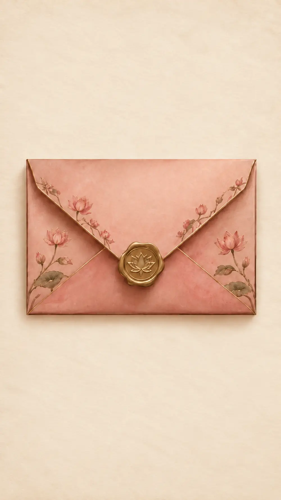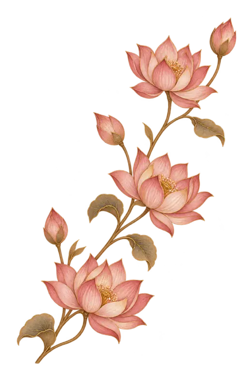<div class="petal-field" aria-hidden="true"></div><p class="envelope-monogram">#VedAm</p><button id="open-envelope" class="seal-trigger" aria-label="Tap the golden seal to open Amulya and Vedant’s wedding invitation"><span class="seal-light" aria-hidden="true"></span></button><h1 id="opening-title">A celebration awaits</h1><button class="tap-open" data-open>Tap to open</button></div>
    <a class="skip-link" href="#welcome">Skip opening</a>
  </section>
  <div class="opening-radiance" aria-hidden="true"></div>
  <main class="invitation" id="invitation" hidden inert tabindex="-1" aria-label="Amulya and Vedant’s wedding invitation">
    <section class="scene hero" id="welcome" aria-labelledby="couple-names">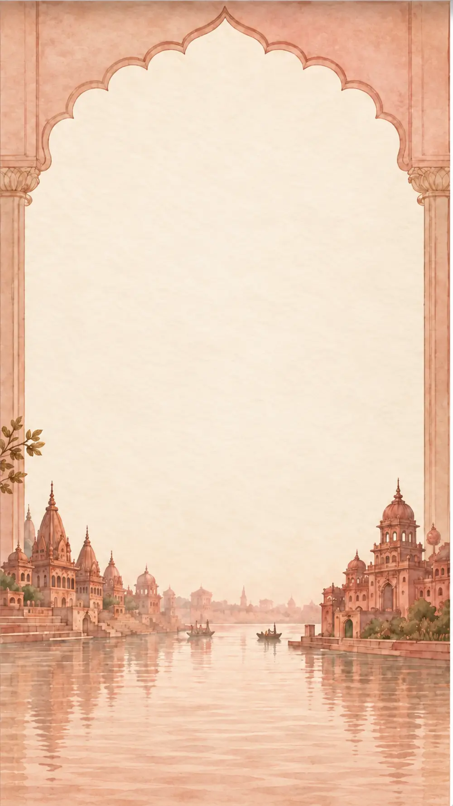<p class="eyebrow hero-eyebrow reveal">Together with their families</p><h2 class="couple-names" id="couple-names"><span class="name-bride reveal">Amulya</span><span class="name-connector reveal">AND</span><span class="name-groom reveal">Vedant</span></h2><div class="hero-information reveal"><p class="hero-date">26 November 2026</p><p class="venue-name">Hotel De Paris</p><p class="address">The Mall Road, Varanasi Cantonment</p></div><a class="pill primary hero-cta reveal" href="#blessings"><span>Begin the celebration</span></a>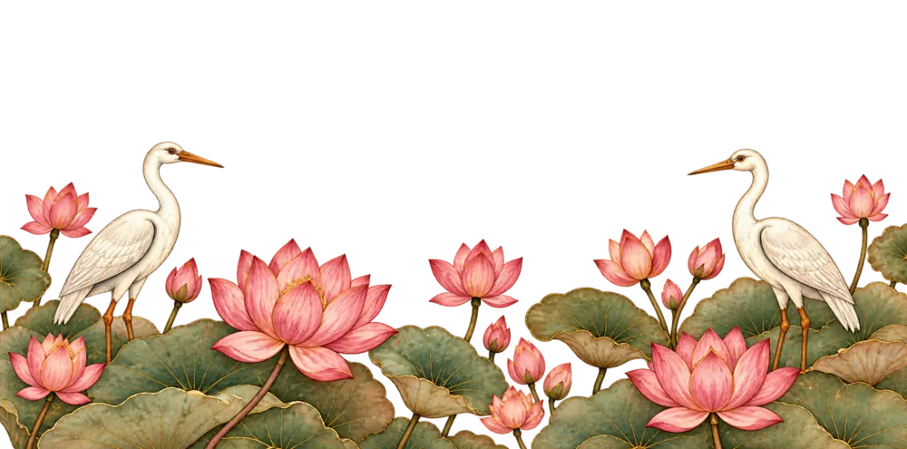<span class="water-shimmer hero-water" aria-hidden="true"></span></section>
    <section class="scene blessings" id="blessings" aria-labelledby="blessing-title">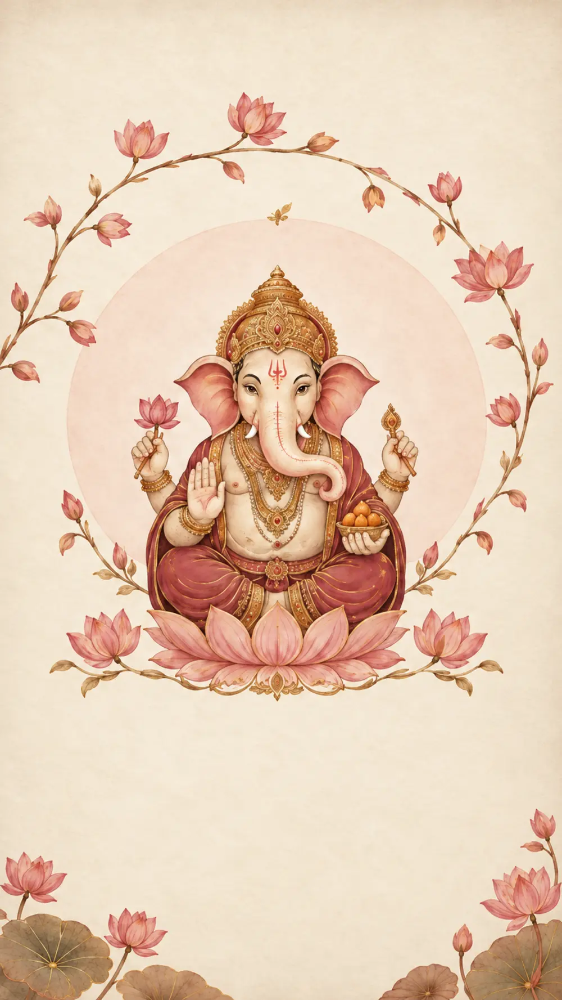<div class="ganesha-halo" aria-hidden="true"></div><h2 id="blessing-title" class="sanskrit reveal" lang="sa">श्री गणेशाय नमः</h2><p class="blessing-copy reveal">With divine blessings,<br>a beautiful new chapter begins.</p></section>
<section class="scene formal" id="wedding-invitation" aria-labelledby="formal-title">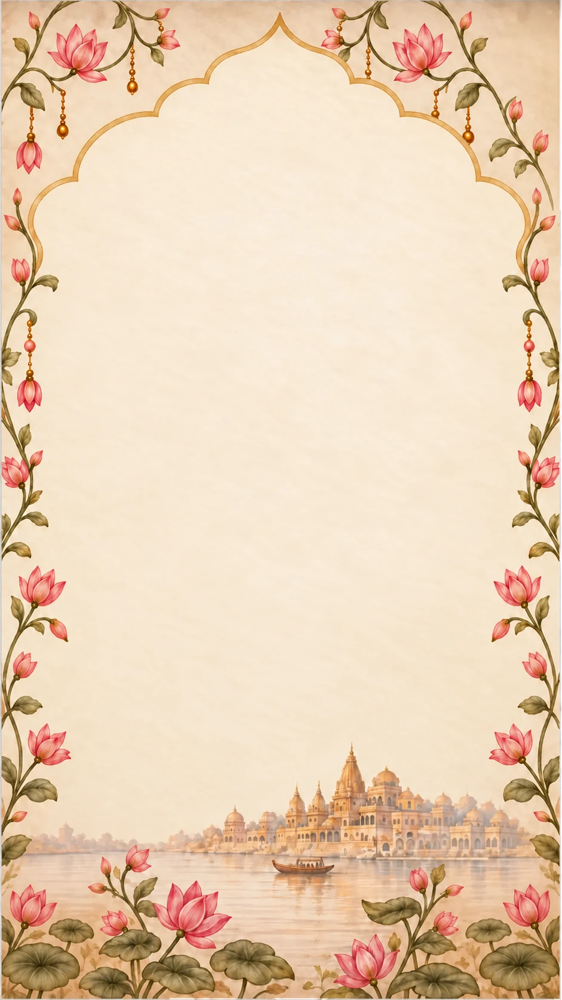<div class="formal-copy"><p class="eyebrow reveal">Together with their families</p><div class="compact-parents reveal"><p>Mrs. Shilpi &amp; Mr. Yogesh Agrawal</p><small>and</small><p>Mrs. Ritu &amp; Mr. Pradeep Jain</p></div><p class="family-request reveal">request the pleasure of your company<br>at the wedding celebration of</p><h2 class="compact-names reveal" id="formal-title">Amulya <i>&amp;</i> Vedant</h2><div class="formal-date reveal"><p>Thursday, 26 November 2026</p><p>7:30 PM</p></div><div class="formal-venue reveal"><h3>Hotel De Paris</h3><p class="address">The Mall Road,<br>Varanasi Cantonment</p></div></div><svg class="peacock peacock-left peacock-rig" viewBox="0 0 500 491" aria-hidden="true" focusable="false"><defs><clipPath id="p-left-head"><path d="M278 0H440V128L375 205L305 182L294 110Z"/></clipPath><clipPath id="p-left-tail"><path d="M0 215L195 152L292 231L232 360L130 491H0Z"/></clipPath><mask id="p-left-body" maskUnits="userSpaceOnUse" x="0" y="0" width="500" height="491"><rect width="500" height="491" fill="white" stroke="none"/><path d="M278 0H440V128L375 205L305 182L294 110Z" fill="black" stroke="none"/><path d="M0 215L195 152L292 231L232 360L130 491H0Z" fill="black" stroke="none"/></mask></defs><g class="peacock-tail" clip-path="url(#p-left-tail)"><image href="assets/v3-peacocks.webp" x="0" y="0" width="1000" height="491"/></g><g mask="url(#p-left-body)"><image href="assets/v3-peacocks.webp" x="0" y="0" width="1000" height="491"/></g><g class="peacock-neck" clip-path="url(#p-left-head)"><image href="assets/v3-peacocks.webp" x="0" y="0" width="1000" height="491"/></g></svg><svg class="peacock peacock-right peacock-rig" viewBox="0 0 500 491" aria-hidden="true" focusable="false"><defs><clipPath id="p-right-head"><path d="M222 0H60V128L125 205L195 182L206 110Z"/></clipPath><clipPath id="p-right-tail"><path d="M500 215L305 152L208 231L268 360L370 491H500Z"/></clipPath><mask id="p-right-body" maskUnits="userSpaceOnUse" x="0" y="0" width="500" height="491"><rect width="500" height="491" fill="white" stroke="none"/><path d="M222 0H60V128L125 205L195 182L206 110Z" fill="black" stroke="none"/><path d="M500 215L305 152L208 231L268 360L370 491H500Z" fill="black" stroke="none"/></mask></defs><g class="peacock-tail" clip-path="url(#p-right-tail)"><image href="assets/v3-peacocks.webp" x="-500" y="0" width="1000" height="491"/></g><g mask="url(#p-right-body)"><image href="assets/v3-peacocks.webp" x="-500" y="0" width="1000" height="491"/></g><g class="peacock-neck" clip-path="url(#p-right-head)"><image href="assets/v3-peacocks.webp" x="-500" y="0" width="1000" height="491"/></g></svg><span class="water-shimmer formal-water" aria-hidden="true"></span></section>
    <section class="scene countdown-scene" id="countdown" aria-labelledby="countdown-title">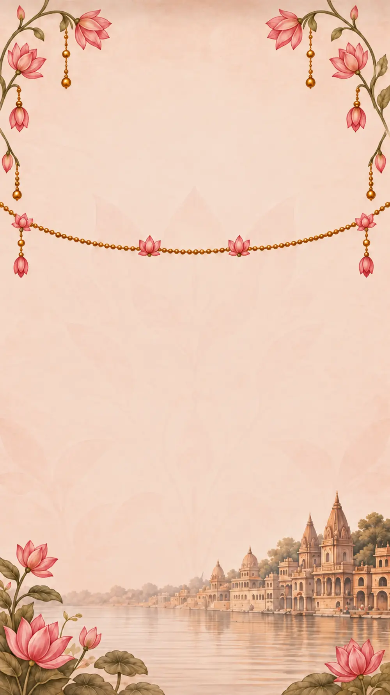<h2 class="section-heading countdown-title reveal" id="countdown-title">Until we celebrate<br>together</h2><div class="countdown" role="timer" aria-label="Time remaining until the wedding"><div class="time-unit">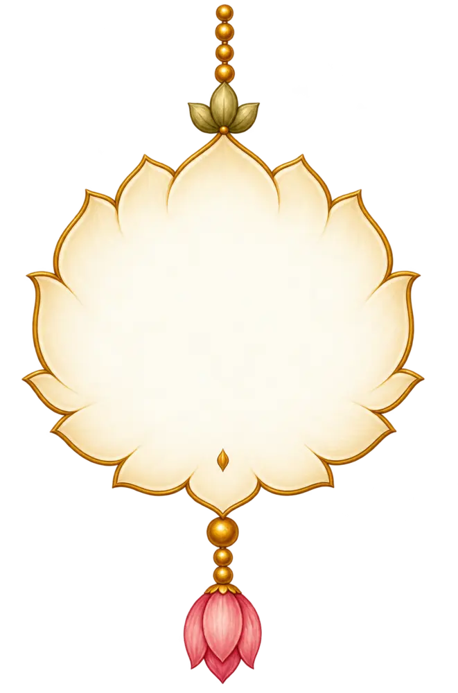<b id="days">00</b><small>Days</small></div><div class="time-unit"><b id="hours">00</b><small>Hours</small></div><div class="time-unit"><b id="minutes">00</b><small>Minutes</small></div><div class="time-unit"><b id="seconds">00</b><small>Seconds</small></div></div><span class="riverboat boat-one ambient" aria-hidden="true"></span><span class="riverboat boat-two ambient" aria-hidden="true"></span><p class="countdown-date reveal">26 November 2026 · 7:30 PM</p><p class="countdown-note" hidden>The celebration has begun.</p></section>
    <section class="scene celebrations" id="celebrations" aria-labelledby="events-title"><h2 class="section-heading events-title reveal" id="events-title">The Celebrations</h2><div class="event-tabs" role="tablist" aria-label="Wedding ceremonies"><button id="tab-0" role="tab" aria-controls="event-0" aria-selected="true" tabindex="0">Mehendi</button><button id="tab-1" role="tab" aria-controls="event-1" aria-selected="false" tabindex="-1">Haldi</button><button id="tab-2" role="tab" aria-controls="event-2" aria-selected="false" tabindex="-1">Wedding</button></div><div class="event-carousel"><div class="events-track">
      <article class="event-card" id="event-0" role="tabpanel" aria-labelledby="tab-0">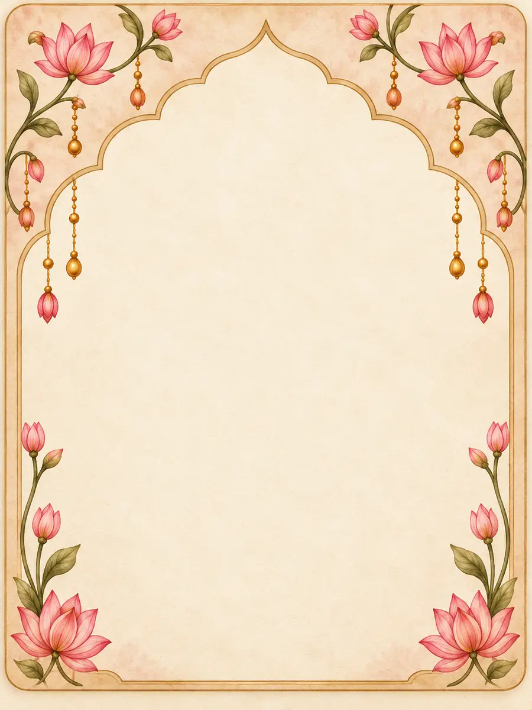<div class="ceremony-art mehendi-art" role="img" aria-label="Decorated bowl with lotus flowers"></div><h3>Mehendi Ceremony</h3><p class="event-date">Tuesday, 24 November 2026<br><span>10:30 AM</span></p><h4>Shakuntala Niwas</h4><p class="event-address">Sunderpur, Varanasi</p><a class="pill directions" href="https://www.google.com/maps/search/?api=1&amp;query=Shakuntala+Niwas%2C+Sunderpur%2C+Varanasi" target="_blank" rel="noopener"><svg><use href="#map"/></svg>View Directions</a></article>
      <article class="event-card" id="event-1" role="tabpanel" aria-labelledby="tab-1" inert><div class="ceremony-art haldi-art" role="img" aria-label="Turmeric bowl and marigold flowers"></div><h3>Haldi Ceremony</h3><p class="event-date">Thursday, 26 November 2026<br><span>9:00 AM</span></p><h4>Hotel De Paris</h4><p class="event-address">The Mall Road,<br>Varanasi Cantonment</p><a class="pill directions" href="https://www.google.com/maps/search/?api=1&amp;query=Hotel+De+Paris%2C+The+Mall+Road%2C+Varanasi+Cantonment" target="_blank" rel="noopener"><svg><use href="#map"/></svg>View Directions</a></article>
      <article class="event-card" id="event-2" role="tabpanel" aria-labelledby="tab-2" inert><div class="ceremony-art wedding-art" role="img" aria-label="Floral wedding mandap with a sacred flame"></div><h3>Wedding Ceremony</h3><p class="event-date">Thursday, 26 November 2026<br><span>7:30 PM</span></p><h4>Hotel De Paris</h4><p class="event-address">The Mall Road,<br>Varanasi Cantonment</p><a class="pill directions" href="https://www.google.com/maps/search/?api=1&amp;query=Hotel+De+Paris%2C+The+Mall+Road%2C+Varanasi+Cantonment" target="_blank" rel="noopener"><svg><use href="#map"/></svg>View Directions</a></article>
      </div><button class="round-arrow event-prev" aria-label="Previous ceremony"><svg><use href="#arrow"/></svg></button><button class="round-arrow event-next" aria-label="Next ceremony"><svg><use href="#arrow"/></svg></button></div><div class="carousel-status"><div class="event-dots"><button class="active" aria-label="Show Mehendi" aria-pressed="true"></button><button aria-label="Show Haldi" aria-pressed="false"></button><button aria-label="Show Wedding" aria-pressed="false"></button></div><p class="event-count" aria-live="polite">1 of 3</p></div></section>
    <section class="scene story" id="our-story" aria-labelledby="story-title"><div class="story-arch">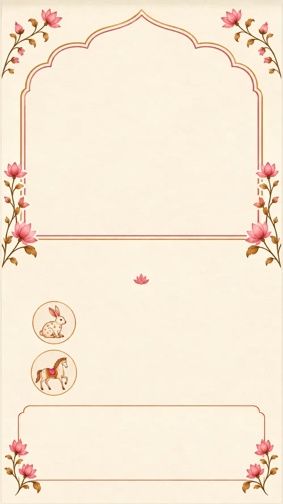<figure class="story-photo reveal">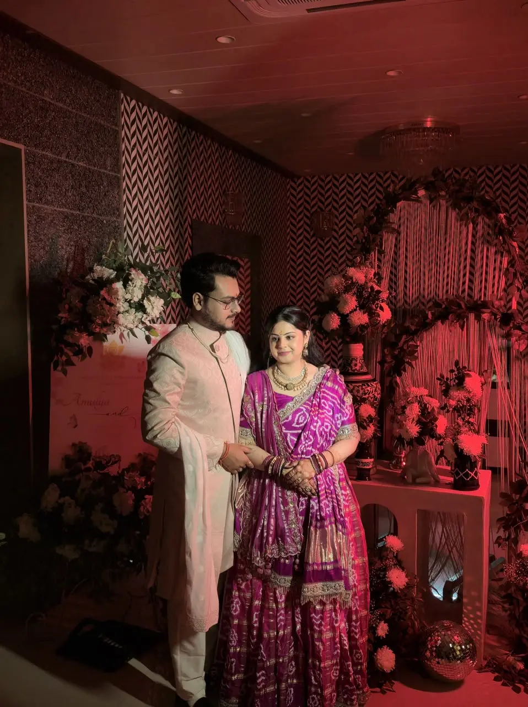</figure></div><h2 class="section-heading story-title reveal" id="story-title">Our Story</h2><div class="person person-bride reveal">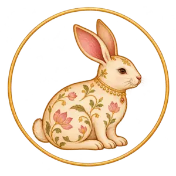<p><strong>Amulya</strong> — A foodie at heart, ambitious and hardworking.</p></div><div class="person person-groom reveal">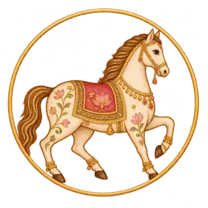<p><strong>Vedant</strong> — An intellectual and a techie, equally at home with healthy meals and street food.</p></div><ol class="milestones"><li class="reveal"><svg><use href="#heart"/></svg><p><strong>Our beginning</strong> · Two hearts, one journey</p></li><li class="reveal"><svg><use href="#ring"/></svg><p><strong>Engaged</strong> · 25 January 2026</p></li><li class="reveal"><svg><use href="#calendar"/></svg><p><strong>Wedding</strong> · 26 November 2026</p></li></ol></section>
    <section class="scene gallery" id="gallery" aria-labelledby="gallery-title">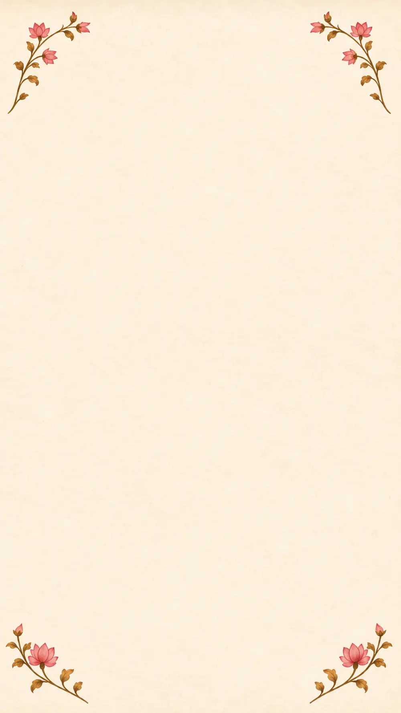<h2 class="section-heading gallery-title reveal" id="gallery-title">A few frames of us</h2><div class="gallery-stage reveal"><figure class="gallery-photo">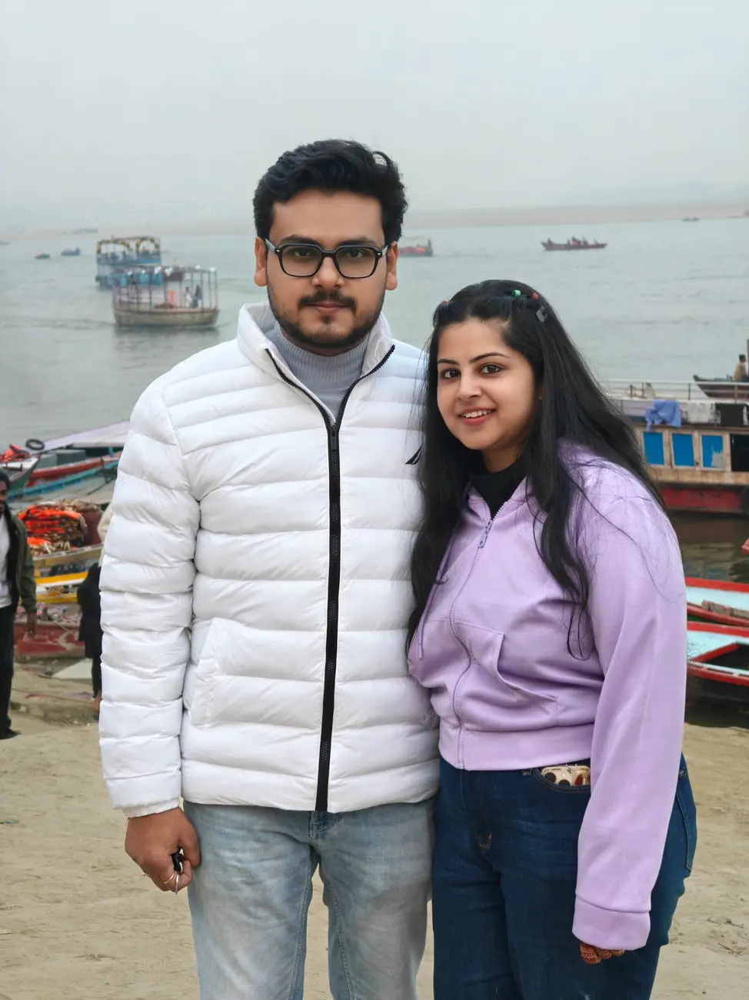</figure><svg class="gallery-frame" viewBox="0 0 100 100" preserveAspectRatio="none" aria-hidden="true"><path d="M6 1H94Q94 3 97 3Q99 3 99 6V94Q99 97 97 97Q94 97 94 99H6Q6 97 3 97Q1 97 1 94V6Q1 3 3 3Q6 3 6 1Z"/></svg><button class="round-arrow gallery-prev" aria-label="Previous photograph"><svg><use href="#arrow"/></svg></button><button class="round-arrow gallery-next" aria-label="Next photograph"><svg><use href="#arrow"/></svg></button></div><div class="gallery-dots"><button class="active" aria-label="Show photograph 1" aria-pressed="true"></button><button aria-label="Show photograph 2" aria-pressed="false"></button><button aria-label="Show photograph 3" aria-pressed="false"></button><button aria-label="Show photograph 4" aria-pressed="false"></button></div><p class="gallery-count" aria-live="polite">1 of 4</p><p class="swipe-hint">Swipe to see more</p><div class="gallery-thumbnails" aria-label="More photographs"></div></section>
    <section class="scene closing" id="wedding-information" aria-labelledby="closing-title">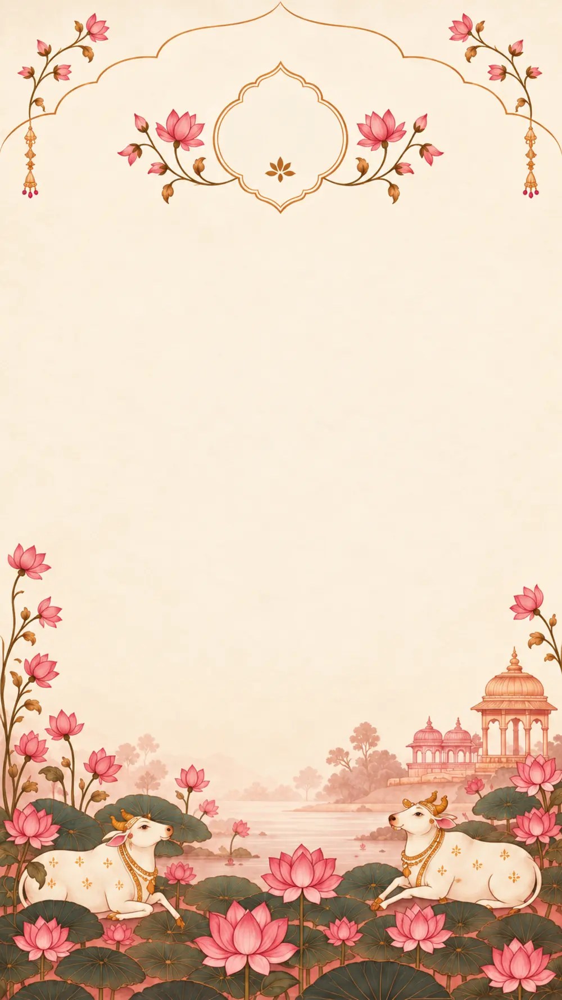<p class="closing-monogram reveal">#VedAm</p><h2 class="section-heading closing-title reveal" id="closing-title">We cannot wait to<br>celebrate with you.</h2>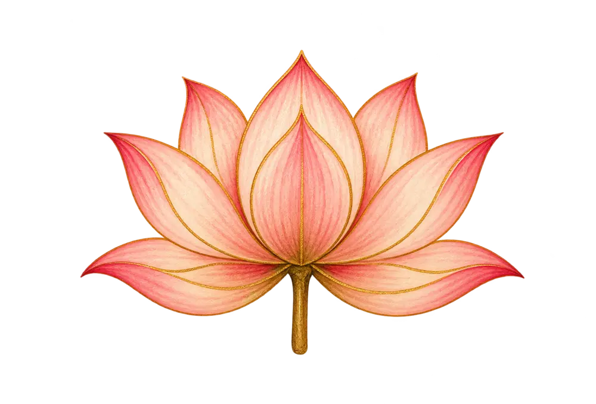<p class="family-blessing reveal">With love and blessings,<br><strong>Agrawal Family</strong></p><div class="closing-actions reveal"><a class="pill primary" id="add-calendar" href="assets/Amulya-and-Vedant-Celebrations.ics" download="Amulya-and-Vedant-Celebrations.ics"><svg><use href="#calendar"/></svg><span>Add to Calendar</span><svg class="action-chevron"><use href="#arrow"/></svg></a><a class="pill" href="https://www.google.com/maps/search/?api=1&amp;query=Hotel+De+Paris%2C+The+Mall+Road%2C+Varanasi+Cantonment" target="_blank" rel="noopener"><svg><use href="#map"/></svg><span>View Directions</span><svg class="action-chevron"><use href="#arrow"/></svg></a><button class="pill share-button" id="share-invitation"><svg><use href="#share"/></svg><span>Share Invitation</span><svg class="action-chevron"><use href="#arrow"/></svg></button></div><div class="closing-petals" aria-hidden="true"></div></section>
  </main>
  <div class="floating-controls" aria-label="Invitation controls"><button id="music-toggle" aria-label="Play instrumental music" aria-pressed="false"><span class="music-disc" aria-hidden="true"></span><svg viewBox="0 0 24 24" aria-hidden="true"><path d="M9 18V5l11-2v13M9 8l11-2"/><ellipse cx="6" cy="18" rx="3" ry="2"/><ellipse cx="17" cy="16" rx="3" ry="2"/></svg><span class="music-slash"></span></button><button id="navigation-toggle" aria-label="Open section navigation" aria-haspopup="dialog"><svg viewBox="0 0 24 24" aria-hidden="true"><path d="M5 6h14M5 12h14M5 18h14"/></svg></button></div>
  <dialog class="navigation-dialog" aria-labelledby="navigation-title"><div class="navigation-inner"><button class="close-nav" aria-label="Close navigation">×</button><p class="eyebrow">AMULYA &amp; VEDANT</p><h2 id="navigation-title">The celebration</h2><svg class="lotus-mark" viewBox="0 0 64 48" aria-hidden="true"><use href="#lotus"/></svg><nav><a href="#welcome">Welcome</a><a href="#blessings">Blessings</a><a href="#wedding-invitation">Invitation</a><a href="#countdown">Countdown</a><a href="#celebrations">Celebrations</a><a href="#our-story">Our Story</a><a href="#gallery">Gallery</a><a href="#wedding-information">Wedding Information</a></nav><p class="nav-date">26 NOVEMBER 2026 · VARANASI</p></div></dialog>
  <dialog class="share-dialog" aria-labelledby="share-title"><button class="close-share" aria-label="Close sharing">×</button><h2 id="share-title">Share the celebration</h2><p>Send a little love to someone you’d like to celebrate with.</p><input id="share-url" aria-label="Invitation link" readonly><button class="pill primary" id="copy-link">Copy invitation link</button></dialog><div class="toast" role="status" aria-live="polite"></div>
  <script src="app.js" defer></script>
</body></html>
```

## styles.css

```css
/* Published stylesheet: refined.css (cascade order preserved) */
@font-face{font-family:Cormorant;src:url('assets/cormorant-v2.woff') format('woff');font-weight:400 700;font-display:swap}
@font-face{font-family:Montserrat;src:url('assets/montserrat-v2.woff') format('woff');font-weight:400 700;font-display:swap}
@font-face{font-family:Ampersand;src:url('assets/ampersand-v2.woff') format('woff');font-style:italic;font-display:swap}
:root{--paper:#f6ead5;--wine:#7e1827;--brown:#6b4637;--gold:#b88a45;--blush:#edbbae;--dock:58px;color:var(--wine);background:var(--paper);font-family:Cormorant,Georgia,serif;font-synthesis:none}
*{box-sizing:border-box}html,body{margin:0;width:100%;height:100%;overflow:hidden}body{background-color:var(--paper);background-image:radial-gradient(ellipse at 10% 20%,#e6b9a91c,transparent 60%),url("data:image/svg+xml,%3Csvg viewBox='0 0 160 160' xmlns='http://www.w3.org/2000/svg'%3E%3Cfilter id='g'%3E%3CfeTurbulence type='fractalNoise' baseFrequency='.72' numOctaves='3' stitchTiles='stitch'/%3E%3C/filter%3E%3Cpath fill='%23836543' opacity='.11' filter='url(%23g)' d='M0 0h160v160H0z'/%3E%3C/svg%3E")}button,a,input{-webkit-tap-highlight-color:transparent}button,input{font:inherit}button,a{touch-action:manipulation}button{cursor:pointer}a{color:inherit;text-decoration:none}button{color:inherit}button:focus-visible,a:focus-visible,input:focus-visible,figure:focus-visible{outline:3px solid var(--wine);outline-offset:4px}button:disabled{cursor:default}p,h1,h2,h3,h4,figure,ol{margin:0}img{display:block;max-width:100%}svg{width:24px;height:24px;fill:none;stroke:currentColor;stroke-width:1.5;stroke-linecap:round;stroke-linejoin:round;flex-shrink:0}.svg-defs{position:absolute;width:0;height:0;overflow:hidden}[hidden]{display:none!important}
.loader{position:fixed;inset:0;z-index:100;display:flex;flex-direction:column;gap:10px;align-items:center;justify-content:center;background:var(--paper);transition:opacity .5s,visibility .5s}.loader span{font-size:38px}.loader small{font:11px Montserrat,sans-serif;letter-spacing:.12em}.ready .loader{opacity:0;visibility:hidden;pointer-events:none}
.invitation{position:relative;width:min(100%,560px);height:calc(100dvh - var(--dock) - env(safe-area-inset-bottom));margin:0 auto;overflow-y:auto;overflow-x:hidden;overscroll-behavior-y:contain;scrollbar-width:none;container-type:inline-size;outline:none}.invitation::-webkit-scrollbar{display:none}.scene{position:relative;isolation:isolate;width:100%;height:177.7778cqw;overflow:hidden;text-align:center}.screen-art{position:absolute;inset:0;z-index:-2;width:100%;height:100%;object-fit:fill;pointer-events:none}.scene::after{content:'';position:absolute;inset:0;pointer-events:none;z-index:4;box-shadow:inset 0 3px 5px -4px var(--paper),inset 0 -3px 5px -4px var(--paper)}.eyebrow{font-size:3.7cqw;line-height:1.35;letter-spacing:.018em}.section-heading{font-size:8.5cqw;font-weight:500;line-height:1.08}.lotus-mark,.button-lotus,.opening-lotus{fill:#dca288;stroke:var(--gold);stroke-width:.8}.lotus-mark{width:11cqw;height:8.25cqw}.pill{display:flex;align-items:center;justify-content:center;gap:10px;border:1px solid var(--gold);border-radius:999px;background:linear-gradient(110deg,#f1cab4,#e7b29f);box-shadow:0 2px 5px #8b54251c;min-height:44px;color:var(--wine);font-weight:500}.pill:hover{filter:brightness(1.035)}.pill:active{transform:translateY(1px)}.pill.primary{background:linear-gradient(110deg,#f0d0b8,#ebb69e)}.pill svg{width:20px;height:20px}.round-arrow{display:grid;place-items:center;width:44px;height:44px;border-radius:50%;background:#f7e5c9e8;border:1px solid #bd8d4a;color:var(--wine);box-shadow:0 2px 7px #744a201c}.round-arrow svg{width:22px;height:22px}.event-prev svg,.gallery-prev svg{transform:rotate(180deg)}
/* The opening is a separate, locked entrance, not the first scroll section. */
.opening{position:fixed;inset:0;z-index:80;background-color:var(--paper);background-image:inherit;overflow:hidden}.opening-stage{position:absolute;left:50%;top:50%;width:min(100vw,56.25dvh,560px);aspect-ratio:9/16;transform:translate(-50%,-50%);container-type:inline-size}.opening-art{position:absolute;inset:0;width:100%;height:100%;object-fit:fill;filter:drop-shadow(0 1px 0 transparent)}.envelope-monogram{position:absolute;left:0;width:100%;top:40.8%;font-size:8.2cqw;line-height:1;font-weight:500;color:#8e473c;text-shadow:0 1px #ffe3c7}.seal-trigger{position:absolute;left:41%;top:48.4%;width:18%;height:10.1%;min-width:54px;min-height:54px;border:0;border-radius:50%;background:transparent;isolation:isolate}.seal-light{position:absolute;inset:-22%;border-radius:50%;background:radial-gradient(ellipse,#fff7ba42,transparent 70%);animation:seal-breathe 3.8s ease-in-out infinite;pointer-events:none}.seal-trigger:hover .seal-light{background:radial-gradient(ellipse,#fff7ba9c,transparent 72%)}#opening-title{position:absolute;top:69.5%;left:5%;width:90%;font-size:6.8cqw;font-weight:500}.tap-open{position:absolute;top:74.2%;left:30%;width:40%;min-height:44px;background:none;border:0;font-size:4.7cqw}.opening-lotus{position:absolute;top:80%;left:45.5%;width:9%;height:auto}.skip-link{position:absolute;bottom:max(16px,env(safe-area-inset-bottom));left:50%;transform:translateX(-50%);padding:14px 20px;font:11px Montserrat,sans-serif;color:var(--brown);text-decoration:underline;text-underline-offset:4px}.opening-radiance{position:fixed;inset:0;z-index:90;pointer-events:none;opacity:0;background:radial-gradient(ellipse at 50% 53%,#fffdf0 0%,#fff2c8 38%,#f9e3b3 80%);transform:scale(.8)}.opening-is-active .opening-radiance{animation:invitation-light 1.55s ease-in-out both}.opening-is-active .seal-light{animation:seal-glow .65s ease-out forwards}.opening-is-active .opening-art{animation:envelope-lift 1.1s ease-out both}.petal-field,.closing-petals{position:absolute;inset:0;overflow:hidden;pointer-events:none}.petal{position:absolute;top:-8%;left:var(--left);width:2.4cqw;height:3.6cqw;max-width:13px;max-height:19px;background:linear-gradient(135deg,#e8a39cba,#f8d8bfbd);border-radius:75% 8% 70% 15%;animation:petal-fall var(--duration) linear var(--delay) infinite;opacity:.68;box-shadow:inset 0 0 2px #bc716c44}.closing-petals .petal:nth-child(1){left:4%}.closing-petals .petal:nth-child(2){left:95%}.closing-petals .petal:nth-child(3){left:1%}
/* Native text is deliberately aligned to the cleaned, approved paintings. */
.hero-eyebrow{position:absolute;top:18%;left:15%;width:70%;font-size:3.9cqw}.couple-names{font-weight:500;line-height:.95}.couple-names>span,.couple-names>i{position:absolute;left:12%;width:76%}.name-bride{top:26%;font-size:16.8cqw}.name-amp{top:35.7%;font:italic 13.8cqw/1 Ampersand,Cormorant,serif;font-weight:400}.name-groom{top:43.1%;font-size:16.8cqw}.hero-information{position:absolute;left:12%;top:54.2%;width:76%;line-height:1.45}.hero-date{font-size:6.5cqw;font-weight:500;line-height:1.15;margin-bottom:2cqw}.venue-name{font-size:max(14px,3.9cqw);font-weight:600}.address{font-size:max(11px,3cqw);line-height:1.5;font-family:Montserrat,sans-serif;font-weight:400}.hero-cta{position:absolute;left:24%;top:67.4%;width:52%;height:6%;font-size:3.65cqw;gap:7px}.hero-cta .button-lotus{width:5cqw;height:4cqw}.water-shimmer{position:absolute;z-index:-1;pointer-events:none;opacity:.16;background:repeating-linear-gradient(0deg,transparent 0 8px,#fff6d033 9px 10px);mask-image:radial-gradient(ellipse,#000,transparent 68%);animation:river-light 8s ease-in-out infinite}.hero-water{left:0;top:82%;width:100%;height:10%}
.ganesha-halo{position:absolute;left:24%;top:24%;width:52%;height:31%;background:radial-gradient(ellipse,#ffe8ab35,transparent 70%);mix-blend-mode:screen;pointer-events:none;animation:halo-light 6s ease-in-out infinite}.sanskrit{position:absolute;top:74.1%;left:8%;width:84%;font:700 6.3cqw/1.4 'Noto Serif Devanagari','Nirmala UI',serif;text-shadow:.25px 0 currentColor}.blessing-copy{position:absolute;top:82.2%;left:14%;width:72%;font-size:4.45cqw;line-height:1.5;font-weight:500}
.formal-eyebrow{position:absolute;top:17.8%;left:14%;width:72%;font-size:3.7cqw}.parents{position:absolute;top:25%;left:7%;width:86%;font-size:4.8cqw;line-height:1.45;font-weight:500}.parents small{display:block;font-size:3.6cqw;margin:1cqw 0}.invitation-line{position:absolute;top:36.8%;left:13%;width:74%;font-size:3.7cqw;line-height:1.4}.formal-names{position:absolute;top:44.1%;left:6%;width:88%;font-size:10.8cqw;line-height:1.15;font-weight:500;white-space:nowrap}.formal-names i{font-family:Ampersand,Cormorant,serif;font-weight:400}.formal-date{position:absolute;top:52.8%;left:14%;width:72%;font-size:4.3cqw;line-height:1.55;font-weight:500}.formal-venue{position:absolute;top:66.1%;left:12%;width:76%}.formal-venue h3{font-size:6.6cqw;font-weight:500;margin-bottom:1.5cqw}.formal-venue .address{font-size:max(11px,2.8cqw)}.formal-water{left:10%;top:85%;width:80%;height:10%}
.countdown-title{position:absolute;left:12%;top:16.4%;width:76%;font-size:8.9cqw}.countdown{position:absolute;left:0;top:43%;width:100%;height:13%;display:grid;grid-template-columns:repeat(4,1fr);padding:0 3%;gap:0}.time-unit{display:flex;flex-direction:column;align-items:center;justify-content:flex-start;line-height:1}.time-unit:nth-child(2),.time-unit:nth-child(3){padding-top:3.3cqw}.time-unit b{font-weight:500;font-size:8.5cqw;font-variant-numeric:tabular-nums;line-height:1}.time-unit small{font-size:max(11px,3.15cqw);font-weight:600;margin-top:.7cqw}.countdown-date{position:absolute;top:66.6%;left:7%;width:86%;font-size:5.5cqw;font-weight:500;white-space:nowrap}.countdown-note{position:absolute;top:72%;left:10%;width:80%;font-size:4.6cqw}
.celebrations{height:200cqw}.events-title{position:absolute;top:9%;left:10%;width:80%;font-size:9.2cqw}.event-tabs{position:absolute;top:17%;left:9%;width:82%;display:flex;justify-content:center;gap:7px}.event-tabs button{min-height:44px;padding:7px 4cqw;border-radius:999px;border:1px solid #bb8c4c;background:#f7ead6;font-size:4.9cqw;font-weight:500}.event-tabs button[aria-selected=true]{background:#e9b79e;border-color:#af7846;box-shadow:inset 0 0 0 1px #e6b38a}.event-carousel{position:absolute;top:25%;left:0;width:100%;height:61%;overflow:hidden;touch-action:pan-y}.events-track{display:flex;gap:20px;padding-left:10%;height:100%;width:100%;transition:transform .55s cubic-bezier(.2,.65,.3,1);will-change:transform}.event-card{position:relative;flex:0 0 88.88889%;height:100%;isolation:isolate;text-align:center}.event-frame{position:absolute;inset:0;width:100%;height:100%;object-fit:fill;z-index:-1}.ceremony-art{position:absolute;left:19%;top:22%;width:62%;height:24%;background-image:url('assets/ceremonies.webp');background-repeat:no-repeat;background-size:300% 100%;mix-blend-mode:multiply}.mehendi-art{background-position:0 50%}.haldi-art{background-position:50% 50%}.wedding-art{background-position:100% 50%}.event-card h3{position:absolute;top:48.5%;left:7%;width:86%;font-size:7.7cqw;line-height:1.05;font-weight:500;white-space:nowrap}.event-date{position:absolute;top:58%;left:8%;width:84%;font-size:4.2cqw;line-height:1.4;font-weight:500}.event-card>.lotus-mark{position:absolute;top:68.6%;left:44%;width:12%;height:7%}.event-card h4{position:absolute;top:75.7%;left:8%;width:84%;font-size:5.3cqw;font-weight:500;line-height:1.1}.event-address{position:absolute;top:81.5%;left:10%;width:80%;font-family:Montserrat,sans-serif;font-size:max(11px,2.9cqw);line-height:1.35}.event-card .directions{position:absolute;left:18%;top:89.3%;width:64%;height:8%;font-size:4.3cqw;gap:6px}.event-card .directions svg{width:18px;height:18px}.event-prev{position:absolute;left:1%;top:43%;z-index:2}.event-next{position:absolute;right:1%;top:43%;z-index:2}.carousel-status{position:absolute;top:87.3%;left:15%;width:70%;display:flex;flex-direction:column;align-items:center;gap:0}.event-count,.gallery-count{font-size:4.4cqw;font-weight:500}.event-dots,.gallery-dots{display:flex;justify-content:center;align-items:center}.event-dots button,.gallery-dots button{position:relative;border:0;background:transparent;width:44px;height:44px;padding:0}.event-dots button::after,.gallery-dots button::after{content:'';position:absolute;left:18px;top:18px;width:8px;height:8px;border:1px solid var(--wine);background:#e2bcb0;border-radius:50%}.event-dots .active::after,.gallery-dots .active::after{background:var(--wine)}
.story-photo{position:absolute;left:8.9%;top:2.05%;width:82.2%;height:44.4%;clip-path:url(#story-clip);overflow:hidden;z-index:-1}.story-photo img{width:100%;height:100%;object-fit:cover;object-position:50% 66%;transform:scale(1.75)}.story-title{position:absolute;left:16%;top:49.8%;width:68%;font-size:9.7cqw}.story-placeholder{position:absolute;top:57.9%;left:12%;width:76%;font-size:4.1cqw;font-style:italic}.person{position:absolute;left:32.5%;width:60%;text-align:left;font-size:4.05cqw;line-height:1.35}.person strong{font-size:4.5cqw;font-weight:600}.person-bride{top:61.6%}.person-groom{top:70.8%}.milestones{position:absolute;top:81.25%;left:13%;width:74%;height:13.5%;padding:0;list-style:none;display:flex;flex-direction:column;justify-content:space-around}.milestones li{display:flex;align-items:center;gap:2cqw;text-align:left;font-size:3.55cqw;line-height:1.3}.milestones svg{width:5cqw;height:5cqw;stroke:var(--gold);flex-shrink:0}.milestones strong{font-weight:600}
.gallery-title{position:absolute;top:7.7%;left:8%;width:84%;font-size:8.9cqw}.gallery-heading-mark{position:absolute;top:12.8%;left:45%;width:10%;height:5%}.gallery-stage{position:absolute;top:18%;left:8%;width:84%;height:44.5%}.gallery-photo{position:absolute;inset:0;clip-path:url(#gallery-clip);overflow:hidden;background:#e8c9af;transition:opacity .25s,transform .4s}.gallery-photo img{width:100%;height:100%;object-fit:cover;object-position:50% 45%;transition:opacity .25s,transform .4s}.gallery-photo.is-changing{opacity:.25;transform:translateX(-6px)}.gallery-frame{position:absolute;inset:0;width:100%;height:100%;stroke:#ad7d3e;stroke-width:.55;fill:none;pointer-events:none}.gallery-prev,.gallery-next{position:absolute;top:44%;z-index:2}.gallery-prev{left:-6%}.gallery-next{right:-6%}.gallery-dots{position:absolute;top:63%;left:15%;width:70%}.gallery-count{position:absolute;top:69%;left:20%;width:60%}.swipe-hint{position:absolute;top:73%;left:20%;width:60%;font-size:3.9cqw;font-family:Cormorant,serif}.gallery-thumbnails{position:absolute;top:78.5%;left:9%;width:82%;height:14%;display:grid;grid-template-columns:repeat(3,1fr);gap:3cqw}.gallery-thumbnails button{border:1px solid var(--gold);padding:3px;border-radius:7px;background:#f1d4b9;overflow:hidden;min-width:44px;min-height:44px}.gallery-thumbnails img{width:100%;height:100%;object-fit:cover;object-position:50% 50%;border-radius:4px}.gallery-end-mark{position:absolute;top:95%;left:45%;width:10%;height:4%}
.closing-monogram{position:absolute;top:12.4%;left:35%;width:30%;font-size:6cqw;line-height:1;font-weight:500}.closing-title{position:absolute;top:26%;left:12%;width:76%;font-size:8.5cqw;line-height:1.08}.closing-mark{position:absolute;top:36.4%;left:44.5%;width:11%;height:5%}.family-blessing{position:absolute;top:41.1%;left:10%;width:80%;font-size:5.1cqw;line-height:1.4;font-weight:500}.family-blessing strong{font-size:6.2cqw;font-weight:500}.closing-actions{position:absolute;top:51%;left:16%;width:68%;display:flex;flex-direction:column;gap:2.4cqw}.closing-actions .pill{width:100%;height:12.5cqw;padding:0 4cqw;justify-content:flex-start;font-size:5.25cqw;gap:3cqw;border-color:#b27d40}.closing-actions .action-chevron{margin-left:auto;width:17px;height:17px}.closing-actions .share-button{background:linear-gradient(110deg,#f3d8b9,#f0d0ad)}
/* The control dock is outside the artwork's scroll viewport, so it never covers a peacock or photograph. */
.floating-controls{position:fixed;left:50%;bottom:0;transform:translateX(-50%);width:min(100%,560px);height:calc(var(--dock) + env(safe-area-inset-bottom));padding:6px 14px calc(6px + env(safe-area-inset-bottom));display:flex;align-items:center;justify-content:flex-end;gap:7px;border-top:1px solid #be915c45;background:#f6ead5;z-index:30;visibility:hidden;opacity:0;transition:opacity .4s}.floating-controls.visible{visibility:visible;opacity:1}.floating-controls>button{position:relative;display:grid;place-items:center;width:44px;height:44px;border:1px solid #b88a456b;border-radius:50%;background:#f5e4cd;color:var(--wine)}.floating-controls svg{width:21px;height:21px}.dock-monogram{margin-right:auto;font-size:23px;display:flex;align-items:center;gap:13px}.dock-monogram small{font:9px Montserrat,sans-serif;letter-spacing:.1em;color:var(--brown)}.music-slash{position:absolute;width:25px;height:1px;background:var(--wine);transform:rotate(-45deg)}.music-playing .music-slash{display:none}.music-playing svg{animation:music-pulse 4s ease-in-out infinite}
dialog{color:var(--wine);background:var(--paper);border:1px solid var(--gold);box-shadow:0 10px 60px #734a3540}dialog::backdrop{background:#694b3940;backdrop-filter:blur(3px)}.navigation-dialog{position:fixed;inset:0 0 0 auto;max-height:100dvh;height:100dvh;width:min(360px,90vw);max-width:90vw;margin:0;padding:0;border-radius:0;border-right:0}.navigation-inner{position:relative;padding:70px 28px 26px;min-height:100%;background-image:radial-gradient(ellipse at 100% 5%,#eab1a838,transparent 55%)}.close-nav,.close-share{position:absolute;right:12px;top:10px;width:44px;height:44px;background:none;border:0;font:30px Cormorant,serif}.navigation-inner>.eyebrow{font:10px Montserrat,sans-serif;letter-spacing:.1em}.navigation-inner h2{font-size:38px;font-weight:500;margin-top:10px}.navigation-inner>.lotus-mark{width:42px;height:34px;margin:16px 0}.navigation-inner nav{display:flex;flex-direction:column}.navigation-inner nav a{min-height:46px;display:flex;align-items:center;font-size:23px;border-bottom:1px solid #b88a4526}.nav-date{font:9px Montserrat,sans-serif;letter-spacing:.08em;margin-top:28px}.share-dialog{padding:55px 26px 28px;width:min(90vw,420px);border-radius:20px}.share-dialog h2{font-size:32px;font-weight:500}.share-dialog p{font-size:19px;line-height:1.4;margin:12px 0 20px}.share-dialog input{width:100%;height:46px;border:1px solid #b88a4580;border-radius:8px;background:#fff8ed;color:var(--brown);padding:10px;font:12px Montserrat,sans-serif}.share-dialog .pill{margin-top:15px;width:100%;font-size:20px}.toast{position:fixed;bottom:calc(75px + env(safe-area-inset-bottom));left:50%;transform:translate(-50%,10px);z-index:110;width:max-content;max-width:90%;padding:12px 18px;background:#fff7e9;border:1px solid #be915c;border-radius:16px;color:var(--wine);font:12px/1.5 Montserrat,sans-serif;text-align:center;opacity:0;pointer-events:none;transition:opacity .25s,transform .25s}.toast.show{opacity:1;transform:translate(-50%,0)}
.motion-enabled .reveal{opacity:0;translate:0 7px;transition:opacity .85s ease,translate .85s ease}.motion-enabled .reveal.is-visible{opacity:1;translate:0 0}.name-amp{transition-delay:.15s!important}.name-groom{transition-delay:.3s!important}.hero-information{transition-delay:.4s!important}.hero-cta{transition-delay:.5s!important}.tick{animation:number-light .35s ease-out}.scene:not(.is-active) .water-shimmer,.scene:not(.is-active) .ganesha-halo,.scene:not(.is-active) .petal{animation-play-state:paused}
@keyframes petal-fall{0%{transform:translate3d(0,-20px,0) rotate(-15deg)}50%{transform:translate3d(16px,85cqw,0) rotate(140deg)}100%{transform:translate3d(-9px,195cqw,0) rotate(295deg)}}@keyframes seal-breathe{0%,100%{opacity:.3;scale:.9}50%{opacity:.9;scale:1.1}}@keyframes seal-glow{to{scale:4;opacity:1;background:radial-gradient(ellipse,#fff9c9,transparent 70%)}}@keyframes invitation-light{0%{opacity:0;transform:scale(.4)}35%{opacity:1;transform:scale(1)}65%{opacity:1;transform:scale(1)}100%{opacity:0;transform:scale(1.1)}}@keyframes envelope-lift{to{transform:translateY(-2%) scale(1.025);filter:brightness(1.25)}}@keyframes river-light{0%,100%{opacity:.08;translate:0 0}50%{opacity:.2;translate:0 2px}}@keyframes halo-light{0%,100%{opacity:.35}50%{opacity:.75}}@keyframes number-light{from{opacity:.45}to{opacity:1}}@keyframes music-pulse{50%{opacity:.5}}
@media(min-width:650px){.invitation{box-shadow:0 0 60px #9a6a3820}.floating-controls{border-left:1px solid #be915c22;border-right:1px solid #be915c22}.opening-stage{box-shadow:0 0 80px #a0703714}}
@media(max-width:340px){.event-tabs{left:5%;width:90%;gap:5px}.event-tabs button{font-size:17px}.event-date{font-size:14px}.event-card h3{font-size:24px}.event-address{font-size:11px}.person{font-size:13px}.person strong{font-size:15px}.milestones li{font-size:11px}.hero-information .address{font-size:10px}.formal-venue .address{font-size:10px}.dock-monogram small{font-size:8px}}
@media(prefers-reduced-motion:reduce){*,*::before,*::after{animation:none!important;transition:none!important;scroll-behavior:auto!important}.motion-enabled .reveal{opacity:1;translate:none}.petal{display:none}.opening-radiance{display:none}}
/* Optical refinements from the 320px and 390px visual review. */
.envelope-monogram{text-align:center}
.opening-art{mask-image:linear-gradient(transparent,#000 1.5%,#000 98.5%,transparent)}
.screen-art{mask-image:linear-gradient(transparent,#000 1.2%,#000 98.8%,transparent)}
.formal-venue{top:64%}
.story-photo img{transform:scale(1.65);object-position:50% 40%}
.event-prev,.event-next{top:35%}
.event-card .directions{top:88%;font-size:max(14px,4.3cqw)}
.event-card>.lotus-mark{height:5.5%}
.event-card h4{top:74.5%}
.event-address{top:80%;line-height:1.2}
.event-date{line-height:1.25}
.carousel-status{top:86.5%;left:23%;width:54%;border-radius:35%;background:radial-gradient(ellipse,#f6ead5f2 25%,#f6ead5b8 55%,transparent 75%)}
.closing{height:max(177.7778cqw,calc(100dvh - var(--dock) - env(safe-area-inset-bottom)))}
.hero-cta{font-size:max(14px,3.65cqw)}
.mehendi-art{background-image:url('assets/mehendi-bowl-v2.webp');background-size:contain;background-position:center;top:17%;height:31%;left:18%;width:64%}
@media(max-width:340px){.hero-information .address,.formal-venue .address{font-size:11px}}


/* Published stylesheet: v3.css (cascade order preserved) */
/* The final correction pass: live content, independently moving painted assets. */
.sr-only{position:absolute;width:1px;height:1px;padding:0;margin:-1px;overflow:hidden;clip:rect(0,0,0,0);white-space:nowrap;border:0}
.hero-date,.formal-date,.countdown-date,.event-date,.time-unit b,.event-count,.gallery-count,.milestones{font-variant-numeric:lining-nums tabular-nums;font-feature-settings:'lnum' 1,'tnum' 1}
.hero-date,.formal-date,.countdown-date,.event-date{font-family:Montserrat,sans-serif;font-weight:500;letter-spacing:0;line-height:1.65}
.botanical{position:absolute;object-fit:contain;pointer-events:none;transform-origin:50% 90%;animation:botanical-breath 7.5s ease-in-out infinite alternate;--lean:0deg;--mirror:1;z-index:1}
.opening-art{animation:none;filter:drop-shadow(0 5px 9px #8c5c3220)}
.opening-flower-left{left:-6%;top:1%;width:28%;height:29%;--lean:6deg;animation-duration:8.5s}
.opening-flower-right{right:-7%;bottom:-2%;width:30%;height:30%;--lean:-9deg;--mirror:-1;animation-delay:-3s}
.envelope-monogram{font-size:8cqw;top:40.5%;font-weight:500;letter-spacing:.015em}
#opening-title{left:0;width:100%;text-align:center;top:69.2%;font-size:6.5cqw;padding:0 5%;line-height:1.15}
.tap-open{left:28%;width:44%;top:75%;min-height:46px;padding:10px 12px;border:1px solid #b78346;border-radius:999px;background:linear-gradient(115deg,#f5d8baee,#eab5a5ee);font:600 max(13px,3.3cqw)/1.2 Montserrat,sans-serif;box-shadow:0 2px 8px #8c542a20;letter-spacing:.015em}
.tap-open:hover{background:#f6d3b1}.petal-field,.closing-petals{display:none}.opening-lotus{display:none}
.name-bride{top:25.2%}.name-groom{top:42.6%}
.couple-names .name-connector{top:37.2%;font:500 3.2cqw/1.1 Montserrat,sans-serif;letter-spacing:.22em;padding-left:.22em;color:#8c4a42}
.hero-information{top:54.2%}.hero-date{font-size:4.6cqw;margin-bottom:1.8cqw;white-space:nowrap}.hero-cta{font-size:max(14px,3.65cqw)}
.hero-foreground{position:absolute;bottom:-1%;left:-1%;width:102%;height:46cqw;object-fit:fill;pointer-events:none;z-index:1;transform-origin:50% 100%;animation:pond-breath 9s ease-in-out infinite alternate}
/* Added ancestry has real space in the document rather than being squeezed over artwork. */
.formal{height:auto;min-height:238cqw;padding:30cqw 13cqw 66cqw}
.formal-copy{position:relative;z-index:2}.formal-copy>.eyebrow{font-size:4cqw;line-height:1.4}
.family-request{font-size:4cqw;line-height:1.4;margin:6cqw 0}
.family-person h3{font-size:12cqw;line-height:1;font-weight:500;margin:0 0 3cqw}
.family-person p{font-size:4.25cqw;line-height:1.35;font-weight:400;margin:2.3cqw 0 0}.family-person strong{font-weight:500}
.family-and{font:500 3cqw/1.4 Montserrat,sans-serif;letter-spacing:.22em;margin:5cqw 0;padding-left:.22em}
.formal .formal-date{position:static;width:100%;margin:8cqw 0 0;font-size:max(12px,3.5cqw);line-height:1.65}
.formal .formal-date p+p{margin-top:1cqw}
.formal .formal-venue{position:static;width:100%;margin-top:5cqw}.formal .formal-venue h3{font-size:7cqw;margin-bottom:1.4cqw}.formal .formal-venue .address{font-size:max(12px,3.2cqw);line-height:1.55}
.peacock{position:absolute;bottom:0;width:50%;height:49.1cqw;background:url('assets/v3-peacocks.webp') no-repeat;background-size:200% 100%;pointer-events:none;z-index:1;animation:peacock-poise 7s ease-in-out infinite alternate}
.peacock-left{left:0;background-position:left;transform-origin:72% 68%}.peacock-right{right:0;background-position:right;transform-origin:28% 68%;animation-delay:-3s;animation-duration:8.3s}
/* Numbers and labels are children of the same swaying ornament. */
.countdown{top:36.7%;height:25%;padding:0 3.2%;gap:.8cqw;align-items:start}
.time-unit{position:relative;height:100%;padding:0!important;transform-origin:50% 0;animation:ornament-sway 7s ease-in-out infinite alternate}
.time-unit:nth-child(2){translate:0 3cqw;animation-delay:-2s;animation-duration:8s}.time-unit:nth-child(3){translate:0 3cqw;animation-delay:-4s;animation-duration:7.8s}.time-unit:nth-child(4){animation-delay:-3s;animation-duration:8.6s}
.time-unit img{position:absolute;inset:0;width:100%;height:100%;object-fit:contain;pointer-events:none}
.time-unit b{position:absolute;left:0;top:41%;width:100%;font:500 6.5cqw/1.15 Montserrat,sans-serif}
.time-unit small{position:absolute;left:0;top:59%;width:100%;font-size:max(11px,3.2cqw);line-height:1.1;margin:0;font-weight:600}
.countdown{top:37.5%;height:auto}.time-unit{height:auto;aspect-ratio:661/1000}.time-unit img{object-fit:fill}.time-unit b{top:37%;font-size:5.8cqw}.time-unit small{top:56%}
.time-unit::before{content:'';position:absolute;left:calc(50% - 1px);top:-8cqw;width:3px;height:8cqw;background:radial-gradient(circle,#bc863b 1px,transparent 1.5px) center top/3px 4px repeat-y}
.time-unit:nth-child(2)::before,.time-unit:nth-child(3)::before{top:-6cqw;height:6cqw}
.countdown-date{top:66.6%;font-size:3.9cqw;font-weight:500}
.riverboat{position:absolute;z-index:1;pointer-events:none;background-image:url('assets/illustration-v2-5.webp');background-repeat:no-repeat;mask-image:radial-gradient(ellipse,#000 50%,transparent 75%);animation:boat-passage 25s ease-in-out infinite alternate}
.boat-one{left:30.5%;top:86.5%;width:12%;height:4.8%;background-size:833.333% 2083.333%;background-position:34.66% 90.86%}
.boat-two{left:46.8%;top:87%;width:14%;height:4.8%;background-size:714.285% 2083.333%;background-position:54.42% 91.39%;animation-delay:-12s;animation-duration:30s}
.event-flower-left{left:-2%;top:-7%;width:25%;height:27%;--lean:163deg;transform-origin:50% 50%;animation-duration:8s}
.event-flower-right{right:-2%;top:-7%;width:25%;height:27%;--lean:163deg;--mirror:-1;transform-origin:50% 50%;animation-delay:-3s}
.events-title{top:9.2%;z-index:2}.event-tabs{z-index:2}
.event-card>.lotus-mark{display:none}.event-date{font-size:max(11px,3.15cqw);line-height:1.6;top:58%}.event-date span{display:block;margin-top:.5cqw}
.event-card h4{top:74%;font-size:5.5cqw}.event-address{top:80%;line-height:1.25}.event-card .directions{top:88%}
/* Photo arch is a fixed-ratio artwork stage; everything below it flows naturally. */
.story{height:auto;padding:0 0 9cqw}.story-arch{height:90cqw;position:relative;overflow:hidden;isolation:isolate}
.story-arch-art{position:absolute;left:0;top:0;width:100%;height:auto;max-width:none;z-index:0}
.story-arch{mask-image:linear-gradient(#000 calc(100% - 6cqw),transparent)}
.story .story-photo{position:absolute;left:8.9%;top:3.56cqw;width:82.2%;height:78.9cqw;z-index:1;clip-path:url(#story-clip)}
.story .story-photo img{object-position:50% 40%;transform:scale(1.65)}
.story-bloom-left{left:-5%;bottom:1%;width:13%;height:26%;--lean:-6deg;z-index:2}.story-bloom-right{right:-5%;bottom:1%;width:13%;height:26%;--lean:-6deg;--mirror:-1;animation-delay:-3s;z-index:2}
.story .story-title{position:static;width:auto;font-size:10cqw;line-height:1.15;margin:2cqw 12cqw 5cqw}
.story .person{position:static;display:grid;grid-template-columns:18cqw 1fr;gap:4cqw;align-items:center;width:auto;margin:0 9cqw 5cqw;font-size:4.5cqw;line-height:1.4;text-align:left}
.person>img{width:18cqw;height:18cqw;object-fit:contain}.story .person strong{font-size:4.8cqw;font-weight:600}.person p br{display:none}
.story .milestones{position:relative;left:auto;top:auto;display:flex;flex-direction:column;justify-content:start;list-style:none;width:auto;height:auto;margin:6cqw 8cqw 0;padding:4cqw 4cqw;gap:3cqw;border:1px solid #b88a45;border-radius:12px;background:#fff8ed60}
.milestones li{font-size:max(12px,3.8cqw);line-height:1.4;align-items:center}.milestones li p{flex:1}.milestones svg{width:5.5cqw;height:5.5cqw}
/* Compact gallery controls and thumbnails form one navigation group. */
.gallery{height:auto;padding:13cqw 8cqw 8cqw}
.gallery .gallery-title{position:static;width:auto;font-size:8.7cqw;margin:0 0 6cqw;line-height:1.15}
.gallery .gallery-stage{position:relative;left:auto;top:auto;width:100%;height:80cqw;margin:0}
.gallery .gallery-dots{position:static;width:100%;height:44px;margin:1cqw 0 0}
.gallery .gallery-count{position:static;width:auto;font-size:4.1cqw;line-height:1.15;margin:0}
.gallery .swipe-hint{position:static;width:auto;font-size:3.9cqw;line-height:1.25;margin:1.8cqw 0 0}
.gallery .gallery-thumbnails{position:static;width:100%;height:28cqw;margin:4cqw 0 0;gap:3cqw}.gallery-heading-mark,.gallery-end-mark{display:none}
.gallery-photo,.events-track{user-select:none;touch-action:pan-y}.gallery-photo img{-webkit-user-drag:none;pointer-events:none;user-select:none}
.closing-monogram{font-size:5.15cqw;top:12.5%}.closing-title{font-size:8.3cqw;top:26%}
.closing .closing-mark{top:35.8%;left:45%;width:10%;height:4.2%;object-fit:contain;animation:lotus-breath 8s ease-in-out infinite alternate}
.family-blessing{top:41.3%;font-size:4.9cqw}.family-blessing strong{font-size:6.1cqw}.closing-actions{top:51.5%;gap:2.5cqw}
.closing-bloom-left{left:-6%;top:49%;width:14%;height:23%;--lean:0deg;animation-duration:9s}.closing-bloom-right{right:-6%;top:53%;width:14%;height:23%;--lean:0deg;--mirror:-1;animation-delay:-5s}
.dock-monogram{font-size:21px;gap:10px}.dock-monogram small{font-size:8px}
.scene:not(.is-active) .ambient,.scene:not(.is-active) .botanical,.scene:not(.is-active) .time-unit{animation-play-state:paused}
@keyframes botanical-breath{from{transform:scaleX(var(--mirror)) rotate(calc(var(--lean) - 1deg))}to{transform:scaleX(var(--mirror)) rotate(calc(var(--lean) + 1deg))}}
@keyframes pond-breath{from{transform:translateY(1px) rotate(-.12deg)}to{transform:translateY(-2px) rotate(.12deg)}}
@keyframes peacock-poise{from{transform:rotate(-.55deg)}to{transform:rotate(.55deg)}}
@keyframes ornament-sway{from{transform:rotate(-1.3deg)}to{transform:rotate(1.3deg)}}
@keyframes boat-passage{from{transform:translateX(-1.5cqw)}to{transform:translateX(3.5cqw)}}
@keyframes lotus-breath{from{transform:rotate(-2deg) translateY(1px)}to{transform:rotate(2deg) translateY(-1px)}}
@media(max-width:340px){.formal{padding-left:10cqw;padding-right:10cqw}.family-person p{font-size:15px}.family-request{font-size:14px}.family-person h3{font-size:40px}.formal-copy>.eyebrow{font-size:14px}.story .person{font-size:15px;margin-left:7cqw;margin-right:7cqw}.story .person strong{font-size:16px}.story .milestones{margin-left:6cqw;margin-right:6cqw}.event-date{font-size:11px}.hero .address{font-size:11px}.countdown-date{font-size:12px}.dock-monogram{font-size:20px;gap:8px}}
@media(prefers-reduced-motion:reduce){.botanical,.ambient,.time-unit,.painted-lotus{animation:none!important}.botanical{transform:scaleX(var(--mirror)) rotate(var(--lean))}}


/* Published stylesheet: v4.css (cascade order preserved) */
/* Final feedback: compact family invitation, visible motion, no faded section seams. */
:root{--dock:0px}
.invitation{height:100dvh;scroll-padding-bottom:80px;box-shadow:none}
.screen-art,.opening-art,.story-arch,.story-arch-art{mask-image:none;-webkit-mask-image:none;filter:none}
.scene::after{display:none;box-shadow:none}.scene{border:0;box-shadow:none}.opening-stage{box-shadow:none}
.formal{height:auto;min-height:177.78cqw;padding:31cqw 8cqw 56cqw}
.compact-parents{margin-top:7cqw;font-size:4.7cqw;line-height:1.35;font-weight:500}.compact-parents small{display:block;font-size:3.8cqw;line-height:1.2;margin:2cqw 0}
.formal .family-request{margin:5cqw 0;font-size:3.9cqw;line-height:1.4}
.compact-names{font-size:10.8cqw;line-height:1.1;white-space:nowrap;font-weight:500}.compact-names i{font-family:Ampersand,Cormorant,serif;font-weight:400}
.formal .formal-date{margin-top:6cqw}.formal .formal-venue{margin-top:5cqw}.formal .formal-venue .address{font-size:max(12px,3.2cqw)}
.botanical{animation:botanical-lively 3.8s ease-in-out infinite alternate}
.botanical:nth-of-type(2n){animation-delay:-1.9s;animation-duration:4.3s}
@keyframes botanical-lively{from{transform:scaleX(var(--mirror)) rotate(calc(var(--lean) - 2.4deg))}to{transform:scaleX(var(--mirror)) rotate(calc(var(--lean) + 2.4deg))}}
/* The torso and feet remain still; only the painted head/neck and feather train move. */
.peacock-rig{width:50%;height:49.1cqw;overflow:visible;background:none;animation:none;fill:none;stroke:none}
.peacock-neck,.peacock-tail{transform-box:view-box;animation:peacock-nod 3.7s ease-in-out infinite alternate;will-change:transform}
.peacock-left .peacock-neck{transform-origin:335px 185px}.peacock-right .peacock-neck{transform-origin:165px 185px;animation-delay:-1.7s;animation-duration:4.2s}
.peacock-tail{animation:peacock-train 4.7s ease-in-out infinite alternate}.peacock-left .peacock-tail{transform-origin:240px 225px}.peacock-right .peacock-tail{transform-origin:260px 225px;animation-delay:-2.2s;animation-direction:alternate-reverse}
.scene:not(.is-active) .peacock-neck,.scene:not(.is-active) .peacock-tail{animation-play-state:paused}
@keyframes peacock-nod{from{transform:rotate(-3deg)}to{transform:rotate(3deg)}}
@keyframes peacock-train{from{transform:rotate(-1.8deg)}to{transform:rotate(1.8deg)}}
/* Real horizontal travel, at adjacent river depths, with no abrupt loop reset. */
.riverboat{animation:boat-journey 14s ease-in-out infinite alternate}
.boat-one{top:86.8%;animation-delay:-2s}.boat-two{top:89%;animation:boat-return 17s ease-in-out -8s infinite alternate}
@keyframes boat-journey{from{transform:translateX(-8cqw)}to{transform:translateX(16cqw)}}
@keyframes boat-return{from{transform:translateX(12cqw)}to{transform:translateX(-12cqw)}}
/* An uninterrupted top-to-bottom stream across the visible viewport, including the envelope. */
.live-petals{position:fixed;top:0;bottom:0;left:50%;transform:translateX(-50%);width:min(100%,560px);height:100dvh;overflow:hidden;contain:paint;pointer-events:none;z-index:85;container-type:inline-size}
.petal-flight{position:absolute;left:var(--petal-left);top:-38px;display:block;width:var(--petal-size);height:calc(var(--petal-size)*1.5);opacity:.78;pointer-events:none;animation:live-petal-fall var(--petal-duration) linear var(--petal-delay) infinite;will-change:transform}
.live-petal-shape{display:block;width:100%;height:100%;stroke:none;pointer-events:none;transform-origin:50% 50%;animation:live-petal-flutter 4s ease-in-out infinite alternate}
.petal-flight:nth-child(even) .live-petal-shape{animation-delay:-2s;animation-duration:3.1s}
@keyframes live-petal-fall{0%{transform:translate3d(0,0,0) rotate(-18deg)}28%{transform:translate3d(var(--petal-drift),30dvh,0) rotate(42deg)}56%{transform:translate3d(0,60dvh,0) rotate(104deg)}80%{transform:translate3d(calc(var(--petal-drift)*-.55),85dvh,0) rotate(158deg)}100%{transform:translate3d(var(--petal-drift),calc(100dvh + 78px),0) rotate(210deg)}}
@keyframes live-petal-flutter{from{scale:.85 1;rotate:-15deg}to{scale:1 .75;rotate:18deg}}
/* Only two floating controls. No footer bar, hashtag or date strip. */
.floating-controls{left:auto;right:max(12px,calc((100vw - 560px)/2 + 12px));bottom:max(12px,env(safe-area-inset-bottom));transform:none;width:110px;height:50px;padding:0;gap:10px;background:none;border:0;box-shadow:none;z-index:88}
.floating-controls>button{width:50px;height:50px;flex:0 0 50px;isolation:isolate;border:1px solid #b68b45;border-radius:50%;background:radial-gradient(circle at 35% 25%,#fff2dc,#edc8ac);box-shadow:0 2px 7px #79502d25,inset 0 0 0 3px #f6e6c9}
.floating-controls>button::after{content:'';position:absolute;inset:5px;border:1px solid #be965c66;border-radius:50%;pointer-events:none}
.floating-controls>button:hover{filter:brightness(1.04)}.floating-controls svg{position:relative;z-index:2;width:22px;height:22px;stroke-width:1.5}.music-playing svg{animation:none}
.music-disc{position:absolute;inset:3px;border:1px solid #b38a4980;border-radius:50%;background:repeating-radial-gradient(circle,transparent 0 4px,#cda56424 4px 5px);animation:music-revolve 7s linear infinite;animation-play-state:paused}
.music-disc::after{content:'';position:absolute;top:3px;left:50%;width:4px;height:4px;background:#9d6f2e;border-radius:50%;box-shadow:0 0 0 1px #fae7c1}
.music-playing .music-disc{animation-play-state:running}.music-slash{z-index:3;width:24px}
#navigation-toggle svg{width:21px;height:21px}.dock-monogram{display:none}
@keyframes music-revolve{to{transform:rotate(360deg)}}
.toast{bottom:80px}.closing{min-height:100dvh}
@media(max-width:340px){.formal{padding-left:6cqw;padding-right:6cqw}.compact-parents{font-size:15px}.compact-names{font-size:33px}.formal .family-request{font-size:13px}}
@media(prefers-reduced-motion:reduce){.live-petals{display:none}.peacock-neck,.peacock-tail,.riverboat,.music-disc,.botanical{animation:none!important}.botanical{transform:scaleX(var(--mirror)) rotate(var(--lean))}}


/* Published stylesheet: v5.css (cascade order preserved) */
/* Approved refinement: seamless covered handover, stacked controls, lively plumage. */
.opening-is-active .opening-radiance{animation:none}
.floating-controls{width:50px;height:110px;flex-direction:column;justify-content:flex-end}
.toast{bottom:130px}
.peacock-neck{animation-duration:2.5s}
.peacock-right .peacock-neck{animation-duration:2.8s;animation-delay:-1.1s}
.peacock-tail{animation:peacock-feather-ruffle 4.6s ease-in-out infinite;will-change:transform}
.peacock-right .peacock-tail{animation-delay:-2.1s;animation-direction:reverse}
@keyframes peacock-feather-ruffle{
  0%,100%{transform:rotate(-2.3deg) scaleX(1)}
  32%{transform:rotate(.5deg) scaleX(1.012)}
  46%{transform:rotate(2.6deg) scaleX(1.035)}
  55%{transform:rotate(1.7deg) scaleX(1.012)}
  64%{transform:rotate(2.6deg) scaleX(1.03)}
}
@media(prefers-reduced-motion:reduce){.peacock-tail,.peacock-neck{animation:none!important}}
```

## app.js

```javascript
'use strict';
const $=(selector,root=document)=>root.querySelector(selector);
const $$=(selector,root=document)=>Array.from(root.querySelectorAll(selector));
const reduceMotion=window.matchMedia('(prefers-reduced-motion: reduce)');
const SITE_URL='https://amulya-vedant-lotus-invitation.thehappyprintclub.chatgpt.site/';
const WEDDING_TIME=Date.parse('2026-11-26T19:30:00+05:30');
let toastTimer;
function notify(message){const el=$('.toast');el.textContent=message;el.classList.add('show');clearTimeout(toastTimer);toastTimer=setTimeout(()=>el.classList.remove('show'),3500);}
function goTo(id){const el=document.getElementById(id);if(el){el.scrollIntoView({behavior:reduceMotion.matches?'instant':'smooth',block:'start'});history.replaceState(null,'','#'+id);}}

// Approved paintings provide the frames; words and interactions remain native layers.
if('IntersectionObserver' in window){
  document.body.classList.add('motion-enabled');
  const revealObserver=new IntersectionObserver(entries=>{for(const entry of entries){if(entry.isIntersecting){entry.target.classList.add('is-visible');revealObserver.unobserve(entry.target);}}},{threshold:.12,rootMargin:'0px 0px -12px 0px'});
  $$('.reveal').forEach(el=>revealObserver.observe(el));
  const sceneObserver=new IntersectionObserver(entries=>{for(const entry of entries)entry.target.classList.toggle('is-active',entry.isIntersecting);},{threshold:.05});
  $$('.scene').forEach(el=>sceneObserver.observe(el));
}
// One viewport-fixed petal stream, independent of opening state and section scrolling.
function buildPetalStream(){const layer=$('#live-petals');layer.replaceChildren();if(reduceMotion.matches)return;const paths=[9,24,39,57,74,91,48];paths.forEach((left,i)=>{const flight=document.createElement('span');flight.className='petal-flight';flight.style.setProperty('--petal-left',left+'%');flight.style.setProperty('--petal-duration',(12+i%4*1.7)+'s');flight.style.setProperty('--petal-delay',(-i*2.1-.5)+'s');flight.style.setProperty('--petal-drift',((i%2?1:-1)*(16+i*2))+'px');flight.style.setProperty('--petal-size',(i%3+9)+'px');flight.innerHTML=`<svg class="live-petal-shape" width="24" height="36" viewBox="0 0 24 36" focusable="false"><defs><linearGradient id="petal-shade-${i}" x1="0" y1="0" x2="1" y2="1"><stop offset="0" stop-color="#f4cfbe"/><stop offset=".55" stop-color="#d58a8b"/><stop offset="1" stop-color="#bd666f"/></linearGradient></defs><path d="M20 2C24 14 18 31 3 34C-3 20 2 7 20 2Z" fill="url(#petal-shade-${i})" stroke="#b36b66" stroke-width=".5"/><path d="M18 6C13 16 8 25 4 31" fill="none" stroke="#ffe6d5" stroke-width=".7" opacity=".55"/></svg>`;layer.appendChild(flight);});}
buildPetalStream();reduceMotion.addEventListener('change',buildPetalStream);

// Original, locally synthesised instrumental ambience. No external tracks or audio requests.
let audioContext, masterGain, musicGain, audioTimer, musicOn=false;
const musicButton=$('#music-toggle');
function initAudio(){if(!audioContext){const Audio=window.AudioContext||window.webkitAudioContext;if(!Audio)return false;audioContext=new Audio();masterGain=audioContext.createGain();masterGain.gain.value=.24;masterGain.connect(audioContext.destination);musicGain=audioContext.createGain();musicGain.gain.value=0;musicGain.connect(masterGain);}if(audioContext.state==='suspended')audioContext.resume().catch(()=>{});return true;}
function note(frequency,at,duration,gainValue,type='sine',destination=musicGain){const osc=audioContext.createOscillator(),amp=audioContext.createGain();osc.type=type;osc.frequency.value=frequency;amp.gain.setValueAtTime(.0001,at);amp.gain.exponentialRampToValueAtTime(gainValue,at+.04);amp.gain.exponentialRampToValueAtTime(.0001,at+duration);osc.connect(amp).connect(destination);osc.start(at);osc.stop(at+duration+.05);osc.onended=()=>{osc.disconnect();amp.disconnect();};}
function softBell(){if(!initAudio())return;const at=audioContext.currentTime;[523.25,784.88,1046.5,1569.75].forEach((freq,i)=>note(freq,at+i*.018,2.2+i*.12,.23/(i+1),'sine',masterGain));}
let phraseIndex=0;
function instrumentalPhrase(){if(!musicOn||document.hidden)return;const at=audioContext.currentTime+.06;[130.81,196.0,261.63].forEach((freq,i)=>note(freq,at,8,.07/(i+1)));const melodies=[[392,440,523.25,587.33],[523.25,440,392,349.23],[392,523.25,587.33,523.25],[440,392,349.23,392]];melodies[phraseIndex++%4].forEach((freq,i)=>{note(freq,at+i*1.65+.6,2.6,.13);note(freq*2,at+i*1.65+.6,1.5,.025);});}
function setMusic(on,{announce=true}={}){if(on&&!initAudio()){notify('Audio is not supported by this browser.');return;}musicOn=on;musicButton.setAttribute('aria-pressed',String(on));musicButton.setAttribute('aria-label',on?'Pause instrumental music':'Play instrumental music');musicButton.classList.toggle('music-playing',on);clearInterval(audioTimer);if(audioContext){musicGain.gain.cancelScheduledValues(audioContext.currentTime);musicGain.gain.setTargetAtTime(on?.72:0,audioContext.currentTime,.3);}if(on){instrumentalPhrase();audioTimer=setInterval(instrumentalPhrase,8000);}if(announce)notify(on?'Music on':'Music paused');}
musicButton.addEventListener('click',()=>setMusic(!musicOn));
document.addEventListener('visibilitychange',()=>{if(!audioContext)return;if(document.hidden){musicGain.gain.setTargetAtTime(0,audioContext.currentTime,.15);}else if(musicOn){musicGain.gain.setTargetAtTime(.72,audioContext.currentTime,.4);instrumentalPhrase();}});

let opened=false;
const invitation=$('#invitation');
// The entrance is removed at full light, never after the light has started fading.
async function openEnvelope({silent=false}={}){
  if(opened)return;
  opened=true;
  const opening=$('#opening'),light=$('.opening-radiance'),controls=$('.floating-controls');
  $('#open-envelope').disabled=true;$$('[data-open]').forEach(b=>b.disabled=true);
  if(!silent)softBell();
  const hero=$('#welcome .screen-art');hero.loading='eager';
  const artReady=hero.decode?hero.decode().catch(()=>{}):Promise.resolve();
  function handover(){
    opening.hidden=true;opening.inert=true;
    invitation.hidden=false;invitation.inert=false;invitation.scrollTop=0;
    document.body.classList.remove('invitation-closed');
    history.replaceState(null,'','#welcome');showEvent(0);
  }
  if(reduceMotion.matches||silent||!light.animate){handover();controls.classList.add('visible');invitation.focus({preventScroll:true});if(!silent)setMusic(true,{announce:false});return;}
  document.body.classList.add('opening-is-active');
  let animation;
  try{
    animation=light.animate([{opacity:0,transform:'scale(.4)'},{opacity:1,transform:'scale(1)'}],{duration:520,easing:'ease-in-out',fill:'forwards'});
    await animation.finished;
    light.style.opacity='1';light.style.transform='scale(1)';animation.cancel();
    await artReady;
    handover();
    // Paint the invitation beneath an opaque light before revealing any of it.
    await new Promise(resolve=>requestAnimationFrame(()=>requestAnimationFrame(resolve)));
    animation=light.animate([{opacity:1,transform:'scale(1)'},{opacity:0,transform:'scale(1.06)'}],{duration:650,easing:'ease-out',fill:'forwards'});
    await animation.finished;
  }catch{
    // A cancelled/unsupported animation still opens the invitation safely.
  }finally{
    light.style.opacity='0';if(animation)animation.cancel();
    if(!opening.hidden)handover();
    document.body.classList.remove('opening-is-active');
    controls.classList.add('visible');invitation.focus({preventScroll:true});
    if(!silent)setMusic(true,{announce:false});
  }
}
$('#open-envelope').addEventListener('click',()=>openEnvelope());$$('[data-open]').forEach(b=>b.addEventListener('click',()=>openEnvelope()));
$('.skip-link').addEventListener('click',e=>{e.preventDefault();openEnvelope({silent:true});});
const nav=$('.navigation-dialog');$('#navigation-toggle').addEventListener('click',()=>nav.showModal());$('.close-nav').addEventListener('click',()=>nav.close());nav.addEventListener('click',e=>{if(e.target===nav&&e.clientX<nav.getBoundingClientRect().left)nav.close();});
$$('.navigation-dialog nav a').forEach(a=>a.addEventListener('click',e=>{e.preventDefault();nav.close();goTo(a.hash.slice(1));}));
$$('a[href^="#"]').filter(a=>!a.closest('dialog')&&!a.classList.contains('skip-link')).forEach(a=>a.addEventListener('click',e=>{e.preventDefault();goTo(a.hash.slice(1));}));

// Countdown uses a fixed, timezone-qualified IST wedding moment for every visitor.
function updateCountdown(){let remaining=Math.max(0,WEDDING_TIME-Date.now());const values=[Math.floor(remaining/86400000),Math.floor(remaining/3600000)%24,Math.floor(remaining/60000)%60,Math.floor(remaining/1000)%60];['days','hours','minutes','seconds'].forEach((id,index)=>{const el=$('#'+id),value=String(values[index]).padStart(2,'0');if(el.textContent!==value){el.textContent=value;if(!reduceMotion.matches){el.classList.remove('tick');void el.offsetWidth;el.classList.add('tick');}}});if(remaining===0)$('.countdown-note').hidden=false;}
updateCountdown();setInterval(updateCountdown,1000);

// Three-tab ceremony carousel with touch, pointer, keyboard and button navigation.
const eventTabs=$$('.event-tabs button'),eventCards=$$('.event-card'),eventDots=$$('.event-dots button'),track=$('.events-track');let eventIndex=0;
function showEvent(index,{focus=false}={}){eventIndex=(index+3)%3;eventTabs.forEach((tab,i)=>{tab.setAttribute('aria-selected',String(i===eventIndex));tab.tabIndex=i===eventIndex?0:-1;});eventCards.forEach((card,i)=>card.inert=i!==eventIndex);eventDots.forEach((dot,i)=>{dot.classList.toggle('active',i===eventIndex);dot.setAttribute('aria-pressed',String(i===eventIndex));});const step=eventCards[0].getBoundingClientRect().width+20;track.style.transform=`translateX(${-eventIndex*step}px)`;$('.event-count').textContent=`${eventIndex+1} of 3`;if(focus)eventTabs[eventIndex].focus({preventScroll:true});}
eventTabs.forEach((tab,i)=>{tab.addEventListener('click',()=>showEvent(i));tab.addEventListener('keydown',e=>{const keys=['ArrowRight','ArrowLeft','Home','End'];if(!keys.includes(e.key))return;e.preventDefault();showEvent(e.key==='Home'?0:e.key==='End'?2:eventIndex+(e.key==='ArrowRight'?1:-1),{focus:true});});});eventDots.forEach((dot,i)=>dot.addEventListener('click',()=>showEvent(i)));$('.event-prev').addEventListener('click',()=>showEvent(eventIndex-1));$('.event-next').addEventListener('click',()=>showEvent(eventIndex+1));
function swipe(el,previous,next){let start=null;function move(x,y){if(!start)return;const dx=x-start.x,dy=y-start.y;if(Math.abs(dy)>22&&Math.abs(dy)>Math.abs(dx)){start=null;return;}if(Math.abs(dx)>55&&Math.abs(dx)>Math.abs(dy)*1.3){start=null;dx<0?next():previous();}}el.addEventListener('dragstart',e=>e.preventDefault());el.addEventListener('pointerdown',e=>{if((e.pointerType==='mouse'&&e.button!==0)||e.target.closest('button,a'))return;start={x:e.clientX,y:e.clientY,id:e.pointerId};try{el.setPointerCapture(e.pointerId);}catch{}});window.addEventListener('pointermove',e=>{if(start&&e.pointerId===start.id)move(e.clientX,e.clientY);},{passive:true});window.addEventListener('pointerup',e=>{if(start&&e.pointerId===start.id){move(e.clientX,e.clientY);start=null;}});el.addEventListener('pointercancel',()=>start=null);if(!window.PointerEvent){el.addEventListener('touchstart',e=>{if(e.touches.length===1)start={x:e.touches[0].clientX,y:e.touches[0].clientY};},{passive:true});el.addEventListener('touchmove',e=>{if(e.touches.length===1)move(e.touches[0].clientX,e.touches[0].clientY);},{passive:true});el.addEventListener('touchend',()=>start=null);}}
swipe($('.events-track'),()=>showEvent(eventIndex-1),()=>showEvent(eventIndex+1));addEventListener('resize',()=>showEvent(eventIndex));

const photos=[{src:'assets/couple-ghats.webp',alt:'Amulya and Vedant at the Varanasi ghats'},{src:'assets/couple-dinner.webp',alt:'Amulya and Vedant sharing a meal together'},{src:'assets/couple-engagement.webp',alt:'Amulya and Vedant at their engagement celebration'},{src:'assets/couple-selfie.webp',alt:'Amulya and Vedant taking a mirror photograph together'}];let photoIndex=0,photoTimer;const galleryImg=$('#gallery-image'),photoFrame=$('.gallery-photo'),photoDots=$$('.gallery-dots button');
function thumbnails(){const wrap=$('.gallery-thumbnails');wrap.replaceChildren();photos.forEach((photo,i)=>{if(i===photoIndex)return;const button=document.createElement('button'),image=document.createElement('img');button.type='button';button.setAttribute('aria-label',`Show photograph ${i+1}`);image.src=photo.src;image.alt=photo.alt;image.loading='lazy';button.append(image);button.addEventListener('click',()=>showPhoto(i));wrap.append(button);});}
function showPhoto(index){photoIndex=(index+photos.length)%photos.length;clearTimeout(photoTimer);photoFrame.classList.add('is-changing');photoTimer=setTimeout(()=>{const photo=photos[photoIndex];galleryImg.src=photo.src;galleryImg.alt=photo.alt;galleryImg.style.objectPosition=photoIndex===2?'50% 70%':'50% 45%';photoFrame.classList.remove('is-changing');photoDots.forEach((dot,i)=>{dot.classList.toggle('active',i===photoIndex);dot.setAttribute('aria-pressed',String(i===photoIndex));});$('.gallery-count').textContent=`${photoIndex+1} of 4`;thumbnails();},reduceMotion.matches?0:180);}
thumbnails();galleryImg.draggable=false;$('.gallery-prev').addEventListener('click',()=>showPhoto(photoIndex-1));$('.gallery-next').addEventListener('click',()=>showPhoto(photoIndex+1));photoDots.forEach((dot,i)=>dot.addEventListener('click',()=>showPhoto(i)));swipe($('.gallery-photo'),()=>showPhoto(photoIndex-1),()=>showPhoto(photoIndex+1));$('.gallery-photo').style.touchAction='pan-y';$('.gallery-photo').tabIndex=0;$('.gallery-photo').setAttribute('aria-label','Photograph gallery. Use left and right arrow keys to browse.');$('.gallery-photo').addEventListener('keydown',e=>{if(e.key==='ArrowLeft'||e.key==='ArrowRight'){e.preventDefault();showPhoto(photoIndex+(e.key==='ArrowRight'?1:-1));}});

// RFC 5545 calendar. UTC DTSTARTs represent the supplied IST times, no invented end times.
const calendarEvents=[{uid:'mehendi',start:'20261124T050000Z',name:'Mehendi Ceremony',venue:'Shakuntala Niwas, Sunderpur, Varanasi'},{uid:'haldi',start:'20261126T033000Z',name:'Haldi Ceremony',venue:'Hotel De Paris, The Mall Road, Varanasi Cantonment'},{uid:'wedding',start:'20261126T140000Z',name:'Wedding Ceremony',venue:'Hotel De Paris, The Mall Road, Varanasi Cantonment'}];
function icsEscape(value){return value.replaceAll('\\','\\\\').replaceAll('\n','\\n').replaceAll(',','\\,').replaceAll(';','\\;');}
function foldLine(line){const encoder=new TextEncoder();let result='',part='';for(const character of line){if(encoder.encode(part+character).length>72){result+=part+'\r\n ';part='';}part+=character;}return result+part;}
function calendarText(){const stamp=new Date().toISOString().replace(/[-:]/g,'').replace(/\.\d{3}/,'');const lines=['BEGIN:VCALENDAR','VERSION:2.0','PRODID:-//Amulya and Vedant//Wedding Invitation//EN','CALSCALE:GREGORIAN','METHOD:PUBLISH','X-WR-CALNAME:Amulya & Vedant — Wedding Celebrations','X-WR-TIMEZONE:Asia/Kolkata'];for(const event of calendarEvents)lines.push('BEGIN:VEVENT',`UID:${event.uid}-2026@amulya-vedant-lotus-invitation`,`DTSTAMP:${stamp}`,`DTSTART:${event.start}`,`SUMMARY:${icsEscape('Amulya & Vedant — '+event.name)}`,`LOCATION:${icsEscape(event.venue)}`,`DESCRIPTION:${icsEscape('With love and blessings, Agrawal Family. All wedding times are in Indian Standard Time.')}`,`URL:${SITE_URL}`,'END:VEVENT');lines.push('END:VCALENDAR');return lines.map(foldLine).join('\r\n')+'\r\n';}
$('#add-calendar').addEventListener('click',()=>notify('Open the calendar file to save all three celebrations.'));

const shareDialog=$('.share-dialog');$('#share-url').value=SITE_URL;
async function copyInvitation(){let copied=false;try{await navigator.clipboard.writeText(SITE_URL);copied=true;}catch{$('#share-url').focus();$('#share-url').select();try{copied=document.execCommand('copy');}catch{copied=false;}}if(copied){notify('Invitation link copied');if(shareDialog.open)shareDialog.close();}else{if(!shareDialog.open)shareDialog.showModal();$('#share-url').focus();$('#share-url').select();notify('Select and copy the invitation link.');}}
$('#share-invitation').addEventListener('click',async()=>{const data={title:'Amulya & Vedant · You’re invited',text:'Join us for our wedding celebrations in Varanasi, 24–26 November 2026. With love and blessings, Agrawal Family.',url:SITE_URL};if(navigator.share){try{await navigator.share(data);return;}catch(error){if(error.name==='AbortError')return;}}shareDialog.showModal();});$('#copy-link').addEventListener('click',copyInvitation);$('.close-share').addEventListener('click',()=>shareDialog.close());shareDialog.addEventListener('click',e=>{if(e.target===shareDialog){const r=shareDialog.getBoundingClientRect();if(e.clientX<r.left||e.clientX>r.right||e.clientY<r.top||e.clientY>r.bottom)shareDialog.close();}});

function ready(){document.body.classList.add('ready');}
if(document.readyState==='complete')ready();else addEventListener('load',ready,{once:true});setTimeout(ready,1800);
// A shared hash must never bypass the seal-led entrance on a fresh visit.
history.scrollRestoration='manual';
```

